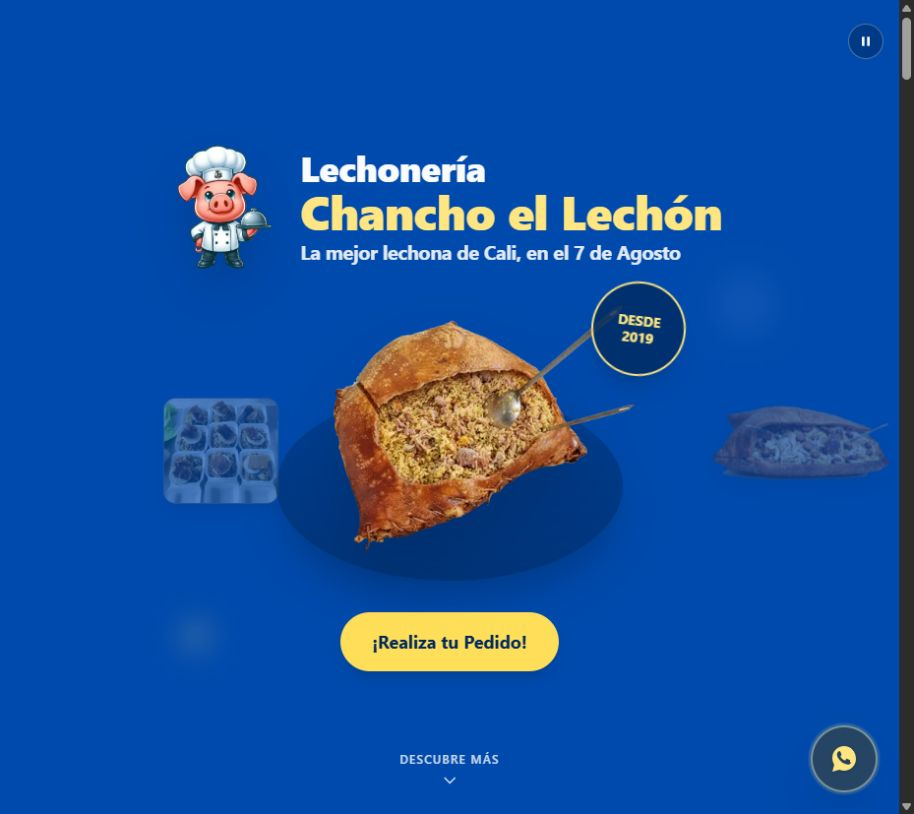

# Lechonería Chancho el Lechón

Sitio de la lechonería Chancho el Lechón, en el barrio Siete de Agosto de Cali. Los visitantes pueden consultar productos y ubicación, cotizar por WhatsApp o enviar una solicitud desde el formulario cuando está configurado.

[Visitar la lechonería](https://lechoneriachanchoellechon.com/) · [Código fuente](https://github.com/jevg2003/chancholechon)

## Vista del sitio



Captura de la portada pública; el envío del formulario depende de la configuración descrita abajo.

## Experiencia del cliente

- Consulta el catálogo con fotos y detalles de los productos.
- Encuentra respuestas frecuentes, la ubicación del negocio y los accesos a WhatsApp.
- Envía una solicitud desde el formulario cuando el sitio tiene configurada la integración. La solicitud entra al flujo de revisión del negocio.

El formulario de solicitudes depende de un backend separado y de su configuración. Sin las variables requeridas, el sitio ofrece WhatsApp como alternativa y desactiva el envío desde el formulario. Este repositorio no incluye un proceso de pago en línea.

## Decisiones técnicas

- [src/pages/index.astro](src/pages/index.astro) reúne las secciones de la portada. [src/components](src/components) contiene el catálogo, el formulario y los accesos de contacto. La interfaz usa Astro, React, Tailwind CSS y GSAP.
- [productModal.ts](src/lib/productModal.ts) utiliza un diálogo nativo para el detalle del producto y la Web Animations API para la transición desde la tarjeta. El código contempla la preferencia de movimiento reducido.
- [astro.config.mjs](astro.config.mjs) define el dominio del sitio y la generación del sitemap.
- [docs/solicitudes-web.md](docs/solicitudes-web.md) documenta la API de solicitudes, App Check, las variables públicas de cliente y la alternativa por WhatsApp.

## Aportes de Jorge Velásquez

Las contribuciones registradas bajo `jevg2003` incluyen:

- [Detalle del producto y transición desde la tarjeta](https://github.com/jevg2003/chancholechon/commit/ab90c9bca73d170681c099758649432157548263), con accesos a WhatsApp y al formulario.
- [Ajustes de experiencia móvil y contenido para búsqueda local](https://github.com/jevg2003/chancholechon/commit/9fe99c98940d5f3560edf763b47a73a5520de610), incluidas imágenes y preguntas frecuentes.
- [Revisión de las animaciones y la sección de presentación](https://github.com/jevg2003/chancholechon/commit/9c9657fdbcbc9765182b8fdcf36a5298c56a6ce3).

Estos enlaces describen aportes concretos de Jorge dentro del historial del proyecto.

## Desarrollo local

Usa Node.js 22.12 o posterior y pnpm 10.34.7, según [package.json](package.json).

```bash
git clone https://github.com/jevg2003/chancholechon.git
cd chancholechon
pnpm install
pnpm dev
```

La terminal indica la URL local. Para preparar producción y revisarla:

```bash
pnpm build
pnpm preview
```

El catálogo y los enlaces de WhatsApp se pueden revisar sin configurar el formulario. Para probar envíos, sigue [la guía de integración](docs/solicitudes-web.md) con un backend y un entorno de pruebas autorizados.

Al revisar la interfaz, abre el detalle de un producto, ciérralo con Escape y prueba los accesos de contacto en una pantalla móvil.

## Licencia

Consulta la [licencia MIT](LICENSE).

## English summary

The website for Chancho el Lechón, a Colombian roast pork restaurant in Cali's Siete de Agosto neighborhood. Visitors can browse products, find the restaurant, request a quote via WhatsApp or submit a request through the configured form. Direct form submission depends on a separately deployed backend.
